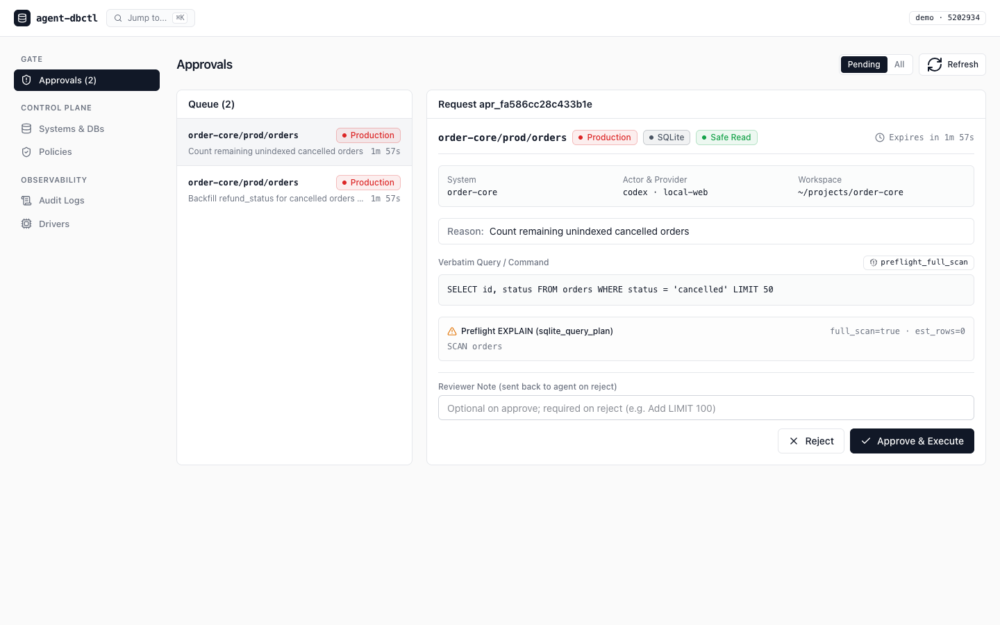
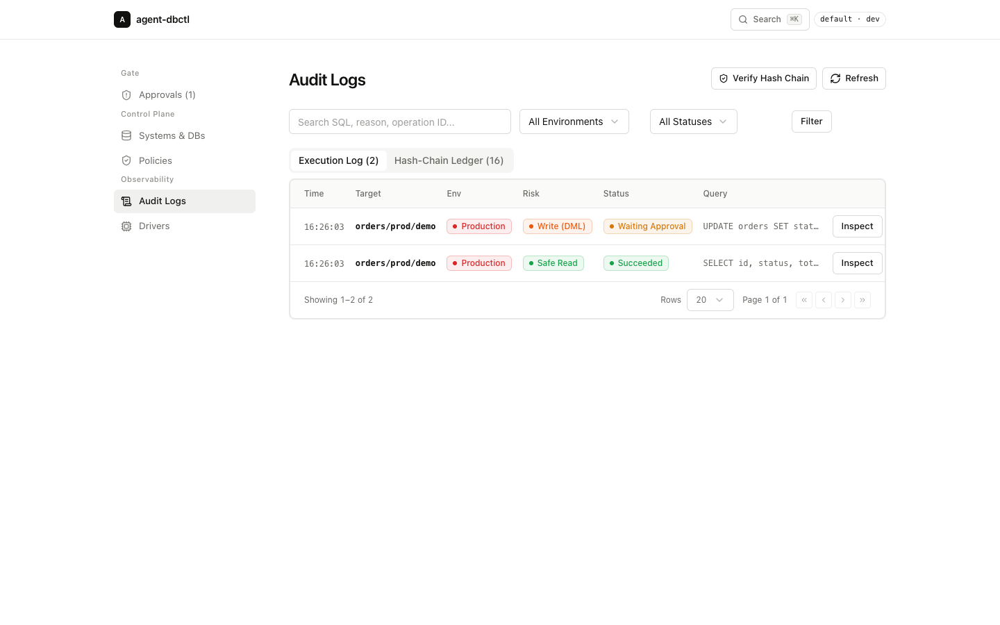

**Languages:** English | [简体中文](README.zh-CN.md)

# agent-dbctl

Run PostgreSQL, openGauss/GaussDB, KingbaseES, Dameng DM8, TDengine, MySQL/TiDB/OceanBase, SQLite, ClickHouse, SQL Server, Oracle, MongoDB, Elasticsearch/Easysearch, and Redis queries safely from Claude Code, Codex, Cursor, and OpenCode. Get EXPLAIN scan preflight, per-environment guardrails, human Web approvals, and immutable hash-chained audit logs in a single zero-JVM binary.

> **100% Local Execution · Zero Telemetry · Zero JVM · Keychain-Backed Credentials · Hash-Chained Audit**



## Supported Platforms

- **macOS** (Apple Silicon `arm64` & Intel `amd64`, Keychain + embedded Web Console)
- **Linux** (`amd64` & `arm64`)
- **Windows** (`amd64` & `arm64`)

## Install

### macOS & Linux (Homebrew)

```sh
brew install x0c/tap/agent-dbctl
```

### macOS & Linux (Shell Installer)

```sh
curl -fsSL https://raw.githubusercontent.com/x0c/agent-dbctl/main/scripts/install.sh | bash
```

### Windows (PowerShell)

```powershell
irm https://raw.githubusercontent.com/x0c/agent-dbctl/main/scripts/install.ps1 | iex
```

Add the installer's reported directory to `PATH` if `agent-dbctl` is not found in a new shell.

<details>
<summary>Alternative: Build from source (Go 1.26.11+ & Node.js 22+)</summary>

```sh
git clone https://github.com/x0c/agent-dbctl.git
cd agent-dbctl
make install-local
```

</details>

## Quick Start

1. **Onboard a database via CLI or the local Web Console** (`127.0.0.1`):

   ```sh
   # Register via CLI without exposing passwords to the agent, then open Web UI to fill the password:
   agent-dbctl db add --engine postgres --host 127.0.0.1 --port 5432 --database app \
     --system order-core --env dev --user app_ro --open-secret --json

   # Or import a sanitized YAML/JSON topology bundle (inspect schema with `topology schema`):
   agent-dbctl topology apply --file topology.yaml --dry-run --json

   # Or open the full Web Console directly:
   agent-dbctl ui open
   ```

2. **Let your coding agent discover targets matching the current repo and inspect or query safely**:

   ```sh
   agent-dbctl db list --json
   agent-dbctl exec --db order-core/prod/orders --preflight --sql "SELECT id, status FROM orders WHERE id = 42" --json
   agent-dbctl exec --db order-core/prod/orders --reason "Fix order state" --wait=false --sql "UPDATE orders SET status = 'paid' WHERE id = 42" --json
   agent-dbctl op status <operation_id> --json
   ```

3. **Automatic companion agent skill**: Running `agent-dbctl` silently syncs `SKILL.md` into detected local agent skill roots (`~/.claude/skills`, `~/.codex/skills`, `~/.cursor/skills`, `~/.config/opencode/skills`, `~/.agents/skills`) without touching unrelated skills or user-edited copies.

   ```sh
   agent-dbctl skill status --json
   # Disable auto-sync if preferred:
   export AGENT_DBCTL_NO_SKILL_SYNC=1
   ```

<p>
  
  
</p>

## Team Server Deployment (Docker Compose)

For central enterprise management (PostgreSQL metadata + AES-GCM encrypted secrets, Redis query relay/pubsub, RBAC users, and remote Web approvals):

```sh
cp .env.example .env
# Edit .env: set POSTGRES_PASSWORD, AGENT_DBCTL_MASTER_KEY (`openssl rand -hex 32`),
# and optionally AGENT_DBCTL_BOOTSTRAP_ADMIN_PASSWORD.
docker compose up -d --build
```

For HTTPS termination with Caddy (`https://dbctl.example.com`):

```sh
# In .env, set SITE_HOST=dbctl.example.com, AGENT_DBCTL_PUBLIC_URL=https://dbctl.example.com,
# and add your domain to allowed_hosts in a copied config referenced by AGENT_DBCTL_CONFIG_FILE.
docker compose --profile tls up -d --build
```

Connect your workstation CLI to the remote server:

```sh
agent-dbctl context add prod --endpoint https://dbctl.example.com --use
agent-dbctl login --token-stdin
```

## Why agent-dbctl?

| Capability | Behavior |
|---|---|
| **Four-Layer Enterprise Catalog** | Organize `System` (with `workspace_paths` + `git_remotes` auto-priority across clones & worktrees) -> `Environment` -> `NetworkProfile` / `CredentialProfile` -> `Instance` / `Target` (`ro_credential_id` & `rw_credential_id` split). Export/import sanitized topology as YAML/JSON. |
| **Environment Safety Tiers** | **`dev` (`yolo`)** runs freely; **`staging` (`guarded`)** & **`prod` (`strict`)** run EXPLAIN preflight and trigger bilingual (English / 中文) Web approvals (requiring `--reason` by default) on writes, DDL, full table scans, or high-cost Redis/Mongo commands. Custom `Policies -> High-Risk Patterns` rules can enforce secondary confirmation or denials even on `dev` targets. |
| **Verbatim Dialect Forwarding** | Native PostgreSQL/HighGo/UXDB, openGauss/GaussDB/Vastbase/GBase 8c, KingbaseES, Dameng DM8, TDengine, MySQL/MariaDB/TiDB/OceanBase/PolarDB/TDSQL/GoldenDB/GBase 8a/Doris/StarRocks, SQLite, ClickHouse, SQL Server, Oracle, MongoDB (`RunCommand` JSON), Elasticsearch/OpenSearch/Easysearch, and Redis commands forwarded verbatim—no lossy ORM or SQL translation. |
| **Agent-Friendly CLI Contract** | Dual-audience TTY tables + `--json` `{ok, data, error, meta}` envelope, single-source `describe`, bounded row/byte truncation on intact boundaries, atomic `--out`, and non-replayable write timeouts. |
| **Pluggable Approvals & Drivers** | Decoupled `ApprovalProvider` (`local-web` built in; extensible to external ticket flows) plus `hashicorp/go-plugin` gRPC external driver subprocesses verified by SHA-256 and `host_api_version`. |
| **Immutable Hash-Chain Audit** | Append-only SQLite WAL `audit_logs` chained via SHA-256 (`agent-dbctl audit verify`) with query result payloads kept out of the audit ledger. |

## Documentation

- [Architecture & Security Boundaries](docs/ARCHITECTURE.md)
- [CLI Contract & Exit Codes](docs/CLI_CONTRACT.md)
- [External gRPC Driver & Approval Plugin Protocol](docs/PLUGIN_PROTOCOL.md)
- [Security Policy](SECURITY.md) · [Contributing](CONTRIBUTING.md) · [Changelog](CHANGELOG.md)

## License

[MIT License](LICENSE)

## Related Tools

| Repository | Description |
|---|---|
| **[corral](https://github.com/corral-dev/corral)** | Search, resume, and hand off local Claude Code, Codex CLI, Cursor, and OpenCode sessions. |
| **[subswap](https://github.com/x0c/subswap)** | Check remaining quota and switch Claude Code, Codex, Cursor, Kimi Code, and OpenCode accounts without logging out. |
| **[agentsync](https://github.com/x0c/agentsync)** | Sync `AGENTS.md`, `CLAUDE.md`, skills, and MCP configs across coding agents from one local source of truth. |
| **[agent-doc-skills](https://github.com/x0c/agent-doc-skills)** | Navigable project knowledge base skills (`doc-init`, `doc-update`, `doc-compact`) for coding agents. |
| **[shell-gate](https://github.com/x0c/shell-gate)** | Self-hosted Go browser terminal gateway for ttyd with passkeys, TOTP 2FA, and persistent tabs. |
| **[sesskit](https://github.com/x0c/sesskit)** | Parse and export local Claude Code, Codex CLI, and Cursor session transcript files from disk. |
