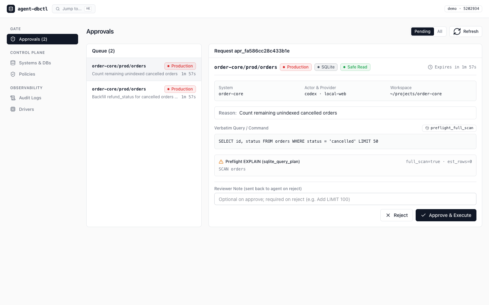
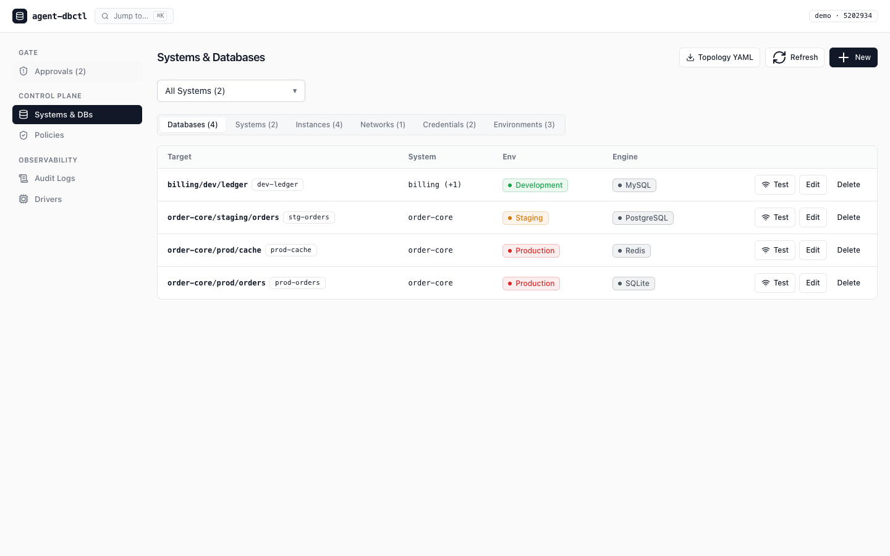
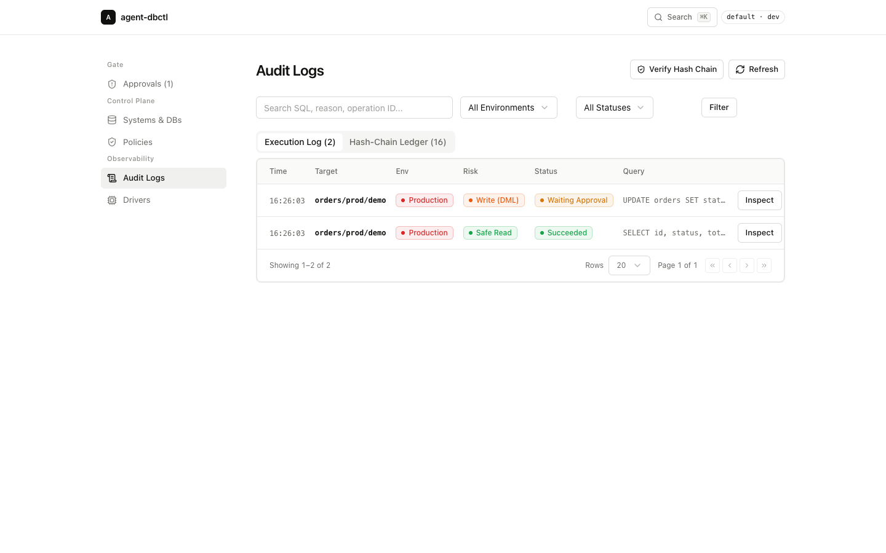

**语言：** [English](README.md) | 简体中文

# agent-dbctl

为 Claude Code、Codex、Cursor 和 OpenCode 提供安全的 PostgreSQL、MySQL、SQLite、ClickHouse、SQL Server、Oracle、MongoDB、Elasticsearch 与 Redis 执行门禁。单个零 JVM 二进制集成 EXPLAIN 预检、分环境策略、本地 Web 人工审批以及防篡改哈希链审计日志。

> **100% 本地运行 · 零遥测 · 零 JVM · 系统钥匙串托管凭据 · SHA-256 哈希链审计**



## 支持的平台

- **macOS**（Apple Silicon `arm64` 与 Intel `amd64`，支持钥匙串凭据托管与内嵌控制台）
- **Linux**（`amd64` 与 `arm64`）
- **Windows**（`amd64` 与 `arm64`）

## 安装

### macOS 与 Linux（Homebrew）

```sh
brew install x0c/tap/agent-dbctl
```

### macOS 与 Linux（一键安装脚本）

```sh
curl -fsSL https://raw.githubusercontent.com/x0c/agent-dbctl/main/scripts/install.sh | bash
```

### Windows（PowerShell）

```powershell
irm https://raw.githubusercontent.com/x0c/agent-dbctl/main/scripts/install.ps1 | iex
```

若新终端提示找不到 `agent-dbctl`，按安装脚本输出将目标目录加入 `PATH` 即可。

<details>
<summary>备选方式：从源码构建（Go 1.26.11+ 与 Node.js 22+）</summary>

```sh
git clone https://github.com/x0c/agent-dbctl.git
cd agent-dbctl
make install-local
```

</details>

## 快速上手

1. **通过 CLI 或本地 Web 控制台**（仅监听 `127.0.0.1`）接入数据库：

   ```sh
   # 通过 CLI 一键注册库与系统（密码留空），自动打开 Web 界面让人工直接录入 Keychain 密码：
   agent-dbctl db add --engine postgres --host 127.0.0.1 --port 5432 --database app \
     --system order-core --env dev --user app_ro --open-secret --json

   # 或导入脱敏 YAML/JSON 拓扑文件（可用 `topology schema` 查看完整格式）：
   agent-dbctl topology apply --file topology.yaml --dry-run --json

   # 或直接打开本地 Web 控制台可视化配置：
   agent-dbctl ui open
   ```

2. **让 Coding Agent 自动识别当前代码仓对应的数据库并安全执行**：

   ```sh
   agent-dbctl db list --json
   agent-dbctl exec --db order-core/prod/orders --preflight --sql "SELECT id, status FROM orders WHERE id = 42" --json
   agent-dbctl exec --db order-core/prod/orders --reason "修复订单状态" --wait=false --sql "UPDATE orders SET status = 'paid' WHERE id = 42" --json
   agent-dbctl op status <operation_id> --json
   ```

3. **自动同步伴随 Agent Skill**：执行 `agent-dbctl` 时会静默将伴随 `SKILL.md` 安装到本机已安装的 Agent 技能目录（`~/.claude/skills`、`~/.codex/skills`、`~/.cursor/skills`、`~/.config/opencode/skills`、`~/.agents/skills` 等），保留用户自定义修改和软链接，不影响任何无关技能。

   ```sh
   agent-dbctl skill status --json
   # 如需关闭自动同步：
   export AGENT_DBCTL_NO_SKILL_SYNC=1
   ```

<p>
  
  
</p>

## 核心特性

| 能力 | 行为说明 |
|---|---|
| **四层企业资产目录** | 按 `系统 (System)`（支持 `workspace_paths` 自动匹配当前目录）-> `环境` -> `网络/凭据模板` -> `实例/目标库`（支持读写凭据分离）管理多库资产，支持脱敏后导出/导入 YAML/JSON 拓扑。 |
| **分环境策略护栏** | **`dev`（YOLO 放行）**免批直跑；**`staging`（守卫）**与 **`prod`（严格）**执行前做只读 `EXPLAIN` 预检，对写操作、DDL、全表扫描或 Redis/Mongo 高开销读自动拉起支持中英文切换的本地 Web 审批（默认强制校验 `--reason` 申请理由）。通过 `Policies -> High-Risk Patterns` 自定义高危规则，在 `dev` 库上命中特定模式同样可强制二次确认或拒绝。 |
| **原生方言原样透传** | 内置纯 Go 支持 PostgreSQL、MySQL/MariaDB/TiDB、SQLite、ClickHouse、SQL Server、Oracle、MongoDB（JSON `RunCommand`）、Elasticsearch/OpenSearch 与 Redis，原样执行各引擎语法，不做易出错的跨库 SQL 改写。 |
| **Agent 友好 CLI 契约** | 终端表格与 `--json` 结构化信封 `{ok, data, error, meta}` 双受众输出，`describe` 自描述、整行边界截断、`--out` 原子落盘、写超时严禁自动重放。 |
| **可插拔审批与外部驱动** | 通过 `ApprovalProvider` 解耦审批通道（内置 `local-web`，可扩展飞书/Slack/内部工单系统）；支持 `hashicorp/go-plugin` 跨语言 gRPC 驱动子进程并校验 SHA-256 与 API 版本。 |
| **不可变哈希链审计** | SQLite WAL 只追加 `audit_logs` 按 SHA-256 逐条成链（`agent-dbctl audit verify`），查询结果集不写入审计库，兼顾可追溯性与数据隔离。 |

## 文档

- [架构设计与安全边界](docs/ARCHITECTURE.md)
- [CLI 契约与退出码](docs/CLI_CONTRACT.md)
- [外部 gRPC 驱动与审批扩展协议](docs/PLUGIN_PROTOCOL.md)
- [安全策略](SECURITY.md) · [贡献指南](CONTRIBUTING.md) · [更新日志](CHANGELOG.md)

## 许可证

[MIT License](LICENSE)

## 关联工具

| 仓库 | 简介 |
|---|---|
| **[corral](https://github.com/corral-dev/corral)** | 统一检索、恢复并交接本地 Claude Code、Codex CLI、Cursor 与 OpenCode 会话历史。 |
| **[subswap](https://github.com/x0c/subswap)** | 查看剩余额度并在 Claude Code、Codex、Cursor、Kimi Code 与 OpenCode 之间免退出切换账号。 |
| **[agentsync](https://github.com/x0c/agentsync)** | 从单一本地真源跨工具同步 `AGENTS.md`、`CLAUDE.md`、Skills 与 MCP 配置。 |
| **[agent-doc-skills](https://github.com/x0c/agent-doc-skills)** | 面向 Coding Agent 的可导航项目知识库技能套件（`doc-init`、`doc-update`、`doc-compact`）。 |
| **[shell-gate](https://github.com/x0c/shell-gate)** | 基于 Go 的自托管 ttyd 浏览器终端网关，支持 Passkey、TOTP 两步验证与持久标签页。 |
| **[sesskit](https://github.com/x0c/sesskit)** | 解析并导出本机 Claude Code、Codex CLI 与 Cursor 会话记录文件。 |
